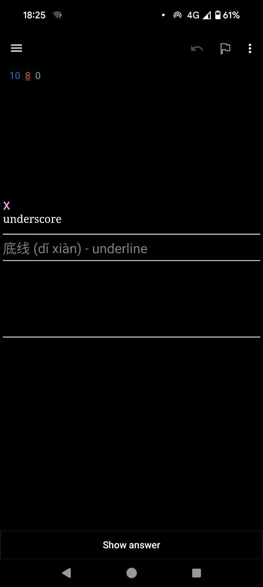
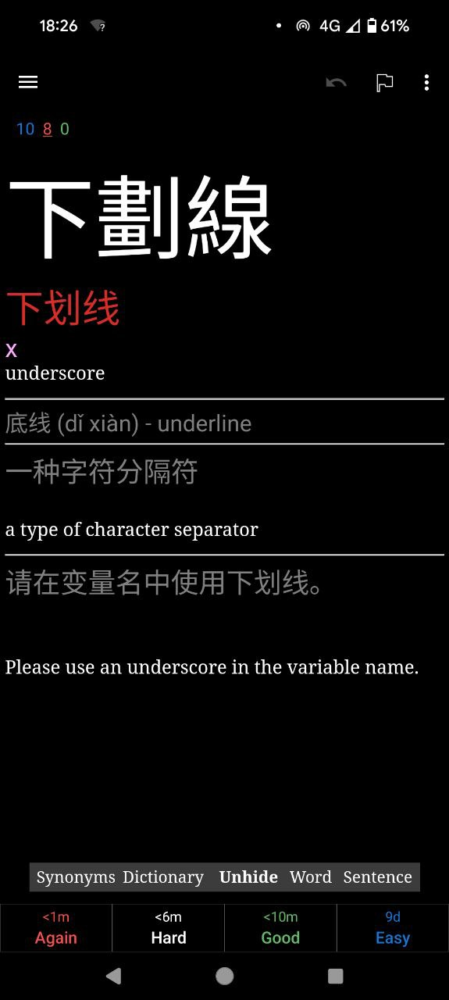
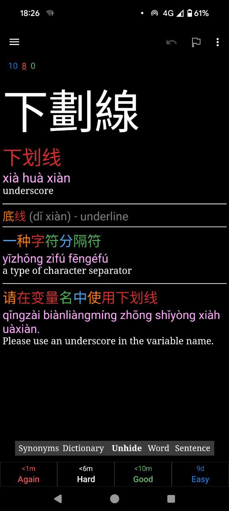

# ankia

Generate Chinese Anki flashcards from messy vocabulary dumps with an LLM, then push them into Anki via AnkiConnect.

## Example

English → Chinese card (front, back hidden, back revealed):

<p align="center">
  
  
  
</p>

## Setup

### 1. Python package

```bash
cd ankia
python -m venv .venv
.venv\Scripts\activate          # Windows
# source .venv/bin/activate     # macOS / Linux
pip install -e ".[dev]"
```

### 2. LLM API key

1. Create an API key for your LLM provider (see `configs/llm/` for the default model config).
2. Copy the example env file and paste your key:

```bash
copy .env.example .env          # Windows
# cp .env.example .env          # macOS / Linux
```

3. Edit `.env`:

```env
GEMINI_API_KEY=your_key_here
```

`.env` is gitignored — never commit the key. `GOOGLE_API_KEY` is accepted as a fallback with the default client.

### 3. Anki + AnkiConnect

Needed only for **export** (pushing cards into Anki). Generation works without it.

1. Install [Anki Desktop](https://apps.ankiweb.net/).
2. In Anki: **Tools → Add-ons → Get Add-ons…**
3. Enter code **`2055492159`** (AnkiConnect) → OK → **restart Anki**.
4. Defaults are fine (`127.0.0.1:8765`, no API key). Keep Anki **open** whenever you run the export command.

## Usage

### Generate cards

1. Paste vocabulary into `data/inbox.txt` (messy dumps are fine).
2. Run:

```bash
python -m pipelines.main
# optional: push into Anki + AnkiWeb sync when done (Anki must be open):
python -m pipelines.main anki.export=true anki.sync=true
```

3. Outputs land in `data/runs/YYYYMMDD_HHMMSS/` (`inbox.txt` snapshot, checkpoints, `cards.jsonl`, `cards.tsv`).
4. When you’re happy with a run, clear `data/inbox.txt` — the run folder keeps the snapshot.

### Export to Anki

With Anki open (if you did not use `anki.export=true`):

```bash
python -m pipelines.export_anki YYYYMMDD_HHMMSS
python -m pipelines.export_anki YYYYMMDD_HHMMSS --sync
```

Default target deck is **`ankia`** (`anki.deck_name` in `configs/main.yaml`, or `--deck` on export). Note type **`Zhongwen`** is created from `data/deck/` only if missing. Duplicates are skipped; existing deck review options are not overwritten.

More detail: [docs/anki-export.md](docs/anki-export.md).

## Pipeline

extract (LLM) → construct (LLM, per card) → color (alignment only) → TSV/jsonl → (optional) AnkiConnect

## Docs

Design and internals: [docs/](docs/README.md).
